# Architecture Design — Documentación del plugin

Plugin de Claude Code para ingeniería de arquitectura gobernada: contexto y evidencia, ASR y solución, decisiones (ADR), conformidad, evolución y handoff a desarrollo. Funciona con **un orquestador y seis skills especialistas**, y cada etapa termina en un **gate con aprobación humana**.

- **Versión:** 1.2.0 · **Estándar de documentos:** STD-OKF-001 v0.1.0-stable
- **Origen:** rediseño de 30 skills originales en 6 especialistas más 1 orquestador (ver `COVERAGE-MATRIX.md`).
- **Invocación:** `/architecture-design:architecture-design-orchestrator`

---

## 1. Skills

| Skill | Gate | Qué hace | Tipos OKF preferentes |
| :--- | :-: | :--- | :--- |
| `architecture-design-orchestrator` | G0–G6 | Planifica, encadena y controla los gates. Genera plan, estado y contratos de ruta por tarea. No produce documentos de arquitectura. | ninguno (planes y gates operativos JSON/YAML) |
| `architecture-context-and-evidence-designer` | G1 | Descubrimiento, contexto y evidencia: discovery, investigación, reconstrucción AS-IS, impacto y crítica del contexto. | `RCP`, `C4` |
| `architecture-asr-and-solution-designer` | G2 | ASR, escenarios de calidad, alternativas, trade-offs y diseño de la solución. | `ASR`, `DSP`, `C4`, `SEQ` |
| `architecture-decision-governor` | G3 | Decisiones: descubrimiento, investigación, análisis, crítica, redacción de ADR y ciclo de vida. | `ADR` |
| `architecture-conformance-assessor` | G4 | Reglas de conformidad, inspección de evidencia, fitness y drift. Condicional. | `C4`, `CFR` |
| `architecture-evolution-governor` | G5 | Señales de cambio, impacto, modelo de gobierno y curaduría de conocimiento. Condicional. | `C4`, `GOV` (los ADR que surjan los redacta `architecture-decision-governor`) |
| `architecture-development-handoff` | G6 | Handoff técnico, trazabilidad y contexto para desarrollo, solo con artefactos aprobados. | `RCP`, `DSP`, `C4`, `SEQ` |

Los 30 skills originales se fusionaron en estos siete. La asignación está en `COVERAGE-MATRIX.md`. Por ejemplo, `asr-discovery`, `asr-quality-scenario-builder` y `architecture-tradeoff-analyzer` pasaron a `architecture-asr-and-solution-designer`. Sus archivos originales (`references/legacy-skills/`) se eliminaron a propósito.

Reglas comunes:

- Separar `FACT`, `INFERENCE`, `ASSUMPTION` y `UNKNOWN`, con procedencia trazable.
- No inventar fuentes, no convertir hipótesis en hechos y no asumir aprobaciones.
- Cada skill devuelve un `output-manifest.json` con `producer`, `inputs`, `outputs`, `sources`, `open_questions`, `gate` y `status`.
- Si el tipo OKF no está aprobado, el documento queda en `draft` y se bloquea la publicación estable.
- Ningún skill ni script aprueba gates.

---

## 2. Secuencia y escenarios

```mermaid
flowchart LR
  G0{{G0 Alcance y plan}} --> S1[context-and-evidence]
  S1 --> G1{{G1 Contexto y evidencia}}
  G1 --> S2[asr-and-solution]
  S2 --> G2{{G2 ASR y solución}}
  G2 --> S3[decision-governor]
  S3 --> G3{{G3 Decisiones}}
  G3 -.condicional.-> S4[conformance-assessor]
  S4 -.-> G4{{G4 Conformidad}}
  G4 -.condicional.-> S5[evolution-governor]
  S5 -.-> G5{{G5 Evolución}}
  G5 --> S6[development-handoff]
  G3 --> S6
  S6 --> G6{{G6 Handoff}}
```



| Orden | Skill | Gate de cierre | ¿Obligatorio? |
| :-: | :--- | :-: | :--- |
| 1 | `architecture-context-and-evidence-designer` | G1 | Sí |
| 2 | `architecture-asr-and-solution-designer` | G2 | Sí |
| 3 | `architecture-decision-governor` | G3 | Sí |
| 4 | `architecture-conformance-assessor` | G4 | Condicional: solo si hay baseline o código verificable |
| 5 | `architecture-evolution-governor` | G5 | Condicional: solo si hay cambio, drift o deuda |
| 6 | `architecture-development-handoff` | G6 | Sí, y solo con artefactos aprobados |

G4 y G5 pueden omitirse, pero la omisión debe justificarse en el plan.

**Escenarios** (los acepta `workflow.py init --scenario`):

| Escenario | Cadena | Tareas | Gates activos | Omitidos |
| :--- | :--- | :-: | :--- | :-: |
| `greenfield` | Contexto → ASR/solución → decisiones → handoff | 4 | G0, G1, G2, G3, G6 | G4, G5 |
| `brownfield` | Reconstrucción AS-IS → análisis → decisiones → conformidad → handoff | 5 | G0, G1, G2, G3, G4, G6 | G5 |
| `evolution` | Contexto + cambio → impacto → decisiones → conformidad/drift → gobierno → handoff | 6 | G0 a G6 | ninguno |

`continuous-governance` se acepta como alias de `evolution`.

Cada tarea **entra por el gate anterior al que cierra**, para que nunca espere el gate que debe cerrar. Un gate omitido queda registrado en `omissions` del plan, y G6 no se aprueba hasta justificar cada omisión con `justify-omission`.

| Escenario | Tareas (skill · entrada → cierre) |
| :--- | :--- |
| `greenfield` | T01 context-and-evidence G0→G1 · T02 asr-and-solution G1→G2 · T03 decision-governor G2→G3 · T04 development-handoff G3→G6 |
| `brownfield` | T01 context G0→G1 · T02 asr-and-solution G1→G2 · T03 decision-governor G2→G3 · T04 conformance-assessor G3→G4 · T05 development-handoff G4→G6 |
| `evolution` | T01 context G0→G1 · T02 asr-and-solution G1→G2 · T03 decision-governor G2→G3 · T04 conformance-assessor G3→G4 · T05 evolution-governor G4→G5 · T06 development-handoff G5→G6 |

---

## 3. Entregables

### 3.1 Documentos OKF

| Sigla | Nombre | Lo producen | Carpeta en el workspace |
| :-: | :--- | :--- | :--- |
| `ADR` | Architecture Decision Record | G3 (único productor: `architecture-decision-governor`) | `architecture/adrs/` |
| `ASR` | Architecturally Significant Requirement | G2 | `architecture/asrs/` |
| `C4` | C4 Architecture View | G1, G2, G4, G5, G6 | `architecture/views/c4/` |
| `SEQ` | Sequence Diagram | G2, G6 | `architecture/views/sequences/` |
| `API` | API Contract | según escenario | `architecture/contracts/apis/` |
| `DSP` | Detailed Solution Proposal | G2, G6 | `architecture/solutions/` |
| `ACP` | Architecture Context Pack | G1 | sin carpeta asignada |
| `CFR` | Conformance Report | G4 | sin carpeta asignada |
| `ADH` | Architecture Development Handoff | G6 | sin carpeta asignada |
| `GOV` | Architecture Governance Record | G5 | sin carpeta asignada |
| `RCP` | Requirements Context Pack | G1, G6 | sin carpeta asignada |
| `RUN` | Runbook | G4, G5 | sin carpeta asignada |

- `ADR` y `ASR` están confirmados por el usuario. El resto son convenciones propuestas del plugin, pendientes de revisión corporativa.
- Un tipo sin mapeo queda `BLOCKED` hasta que el orquestador pida una decisión.

### 3.2 Entregable de cada skill

Cada skill entrega además un `output-manifest.json` que asocia los archivos producidos con su gate y su estado (`pending_human_review` hasta que haya revisión).

### 3.3 Registros del orquestador

En `.comsatel/architecture-design/runs/<run-id>/`:

- `state.json`: estado de G0–G6 y de cada tarea.
- `execution-plan.json`: escenario, tareas y política de gates.
- `routing-contracts.json`: `document_type` y carpeta de salida por tipo.

Los entregables especializados nunca se escriben en `comsatel/`.

---

## 4. Gates

| Código | Significado | Lo aprueba | Verifica |
| :-: | :--- | :--- | :--- |
| `G0` | **Alcance y plan:** escenario, fuentes y plan aprobados antes de ejecutar. El orquestador carga el pathmap y crea los contratos de ruta. | Arquitecto | Alcance, escenario, fuentes, plan y versión del pathmap |
| `G1` | **Contexto y evidencia:** contexto, evidencia, AS-IS e impacto suficientes y trazables. | Arquitecto | Trazabilidad, suficiencia de evidencia y decisiones pendientes |
| `G2` | **ASR y solución:** ASR, escenarios de calidad, alternativas, trade-offs y solución propuesta. | Arquitecto | Que cada ASR tenga escenario medible y la solución lo cubra |
| `G3` | **Decisiones:** ADR redactados y con ciclo de vida definido. | Arquitecto | Decisiones documentadas con alternativas y consecuencias |
| `G4` | **Conformidad (condicional):** conformidad, fitness y drift evaluados contra evidencia verificable. | Arquitecto | Que haya baseline o código verificable |
| `G5` | **Evolución (condicional):** cambio, impacto y gobierno continuo definidos. | Arquitecto | Que exista cambio, drift o deuda que justifique la etapa |
| `G6` | **Handoff:** paquete listo para desarrollo, solo con artefactos aprobados. | Arquitecto | Rutas reales con `validate_pathmap.py`, metadatos con `validate_okf.py` y aprobaciones humanas |

- Cada gate exige revisión humana independiente. No se registra `approved` por haber ejecutado un script.
- Cada skill productor informa `type`, destino, resultado de validación y procedencia de fuentes. El gate se bloquea si una ruta no está resuelta.
- Estado inicial de todos los gates: `pending_human_approval`.
- Checklist de cada gate (`references/gate-checklist.md`): trazabilidad, suficiencia de evidencia, decisiones pendientes y aprobación explícita del arquitecto.

---

## 5. Uso

```bash
# crear un run: greenfield | brownfield | evolution (genera plan, estado, scope y rutas)
python scripts/workflow.py init --root <workspace> --run-id RUN-001 --scenario brownfield
python scripts/workflow.py check --root <workspace> --run-id RUN-001

# aprobar gates (solo actor humano) y mover tareas
python scripts/workflow.py approve-gate --root <workspace> --run-id RUN-001 --gate G0 --actor human:<nombre> --evidence <ref>
python scripts/workflow.py transition --root <workspace> --run-id RUN-001 --task T01 --to READY --actor orchestrator --reason "G0 aprobado"
python scripts/workflow.py transition --root <workspace> --run-id RUN-001 --task T01 --to NEEDS_REVIEW --actor orchestrator --reason "entregado" --manifest <output-manifest.json>
python scripts/workflow.py justify-omission --root <workspace> --run-id RUN-001 --gate G5 --text "<motivo>"
python scripts/workflow.py status --root <workspace> --run-id RUN-001

# validar documentos
python scripts/validate_okf.py <documento.md>
python scripts/validate_pathmap.py ...
```

`validate_okf.py` revisa solo el frontmatter estructural. No valida semántica, fuentes reales, enlaces ni aprobación humana. Los tipos de v1.3.0 están aprobados: `--allow-draft-types` se conserva solo por compatibilidad. Las plantillas llevan placeholders y no deben publicarse sin completarlos.

---

## 6. Observaciones detectadas al documentar

1. **Resuelto:** las referencias a `references/legacy-skills/` y a `references/workflow.md` se retiraron de los `SKILL.md`, `assets/README.md`, `gate-checklist.md`, `technical-guidance.md`, `README.md` y `COVERAGE-MATRIX.md`.
2. **`RCP` y `RUN` no tienen carpeta en el pathmap.** `RUN` ya no es preferente de G4 ni G5 (desde 1.1.0); `RCP` sigue siendo preferente de G1 y G6. Según las reglas del pathmap, un tipo sin mapeo queda `BLOCKED`. Además, el pathmap dice que el plugin no debe generar `RCP` porque es de Requirements Engineering, pero dos skills lo listan como preferente.
3. **Resuelto:** `workflow.py` planifica ahora cada escenario con su propia cadena, gates de entrada y de cierre, `check`, `transition`, `approve-gate` y `justify-omission`. Un manifiesto de salida válido es obligatorio para pasar una tarea a `NEEDS_REVIEW` o `DONE`.
4. **Resuelto (1.1.0):** `plugin.json` y `README.md` declaran la misma versión. El pathmap está en 1.2.0.
5. **`API` no tiene skill productor claro.** Está en el pathmap, pero ningún skill lo lista como tipo preferente.
