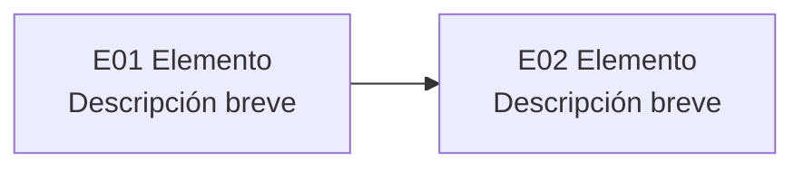

# PRODUCT-ADR-000 — TÍTULO POR DEFINIR

- **Estado:** Propuesto
- **Fecha:** REPLACE_WITH_DATE
- **Decisor:** [PENDIENTE: persona responsable con nombre]
- **ASR relacionados:** [PENDIENTE: IDs o "ninguno"]
- **Depende de / Reemplaza a:** —

## Contexto y drivers

(Drivers de negocio y restricciones. Cada uno con su fuente.)

## Escenarios de calidad afectados

| ID | Atributo | Fuente | Estímulo | Artefacto | Entorno | Respuesta | Medida | Prioridad |
|---|---|---|---|---|---|---|---|---|
| QA-01 | [PENDIENTE] | [PENDIENTE] | [PENDIENTE] | [PENDIENTE] | [PENDIENTE] | [PENDIENTE] | [PENDIENTE: arquitecto] | [PENDIENTE] |

## Opciones consideradas

(Al menos dos opciones, incluida la de no hacer nada. Si el decisor no registró alternativas, abrir con: "Las opciones y sus pros y contras son una reconstrucción del agente. El decisor no registró el análisis de alternativas.")

## Decisión

(Una frase con exactamente lo decidido. Sub-decisiones no tomadas van a "Riesgos, dependencias y preguntas abiertas". Justificación con referencia a QA-nn.)

## Representación visual

(Un diagrama por decisión como mínimo; de preferencia, todo ADR. Si no aplica, escribir una sola línea: `Visual: no aplica — <motivo>`.)

### Catálogo de elementos

| ID | Elemento | Descripción | ¿Punto de variación? | VP | Trazabilidad |
|---|---|---|---|---|---|
| E01 | [PENDIENTE] | [PENDIENTE] | No | — | [PENDIENTE] |
| E02 | [PENDIENTE] | [PENDIENTE] | No | — | [PENDIENTE] |

### Puntos de variación

| ID | Dimensión de variación | Variantes | Momento de vinculación | Valor por defecto | Responsable | Relación ATAM |
|---|---|---|---|---|---|---|
| VP-01 | [PENDIENTE] | [PENDIENTE] | diseño / construcción / despliegue / ejecución | [PENDIENTE] | [PENDIENTE] | [PENDIENTE] |

## Evaluación ATAM

| Tipo | ID | Descripción | Escenario | Atributos en conflicto | Mitigación o condición |
|---|---|---|---|---|---|
| Sensibilidad | S-01 | [PENDIENTE] | QA-01 | [PENDIENTE] | [PENDIENTE] |
| Compromiso | T-01 | [PENDIENTE] | QA-01 | [PENDIENTE] | [PENDIENTE] |
| Riesgo | R-01 | [PENDIENTE] | QA-01 | [PENDIENTE] | [PENDIENTE] |
| No-riesgo | N-01 | [PENDIENTE] | QA-01 | [PENDIENTE] | [PENDIENTE] |

## Consecuencias

- **Positivas:**
- **Negativas y riesgos:**
- **Impacto en pruebas:**

## Riesgos, dependencias y preguntas abiertas

(Lo que no se decidió, quién lo decide y cómo se confirma.)

## Evidencia y procedencia

(Cada fuente en el frontmatter `sources` con `id` y `resource`. Cada afirmación del cuerpo marcada como FACT, INFERENCE, ASSUMPTION o UNKNOWN.)

> TEMPLATE: reemplazar todos los `[PENDIENTE]` y los textos entre paréntesis por valores reales. `sources: []` solo si hay justificación de creación original. No publicar placeholders. Validar con `scripts/validate.py` (frontmatter y cuerpo).
