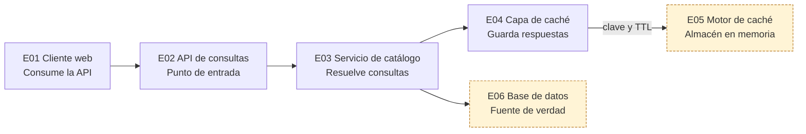
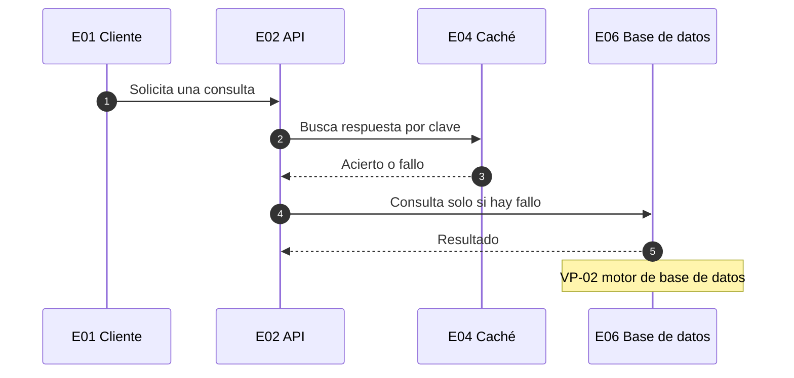

# EJEMPLO-ADR-001 — Caché distribuida para consultas de catálogo

- **Estado:** Propuesto
- **Fecha:** 2026-10-31
- **Decisor:** [PENDIENTE: arquitecto responsable]
- **ASR relacionados:** ninguno

## Contexto y drivers

- Las consultas de catálogo repiten el mismo resultado cientos de veces por minuto (src-1, ficticio).

## Escenarios de calidad afectados

| ID | Atributo | Fuente | Estímulo | Artefacto | Entorno | Respuesta | Medida | Prioridad |
|---|---|---|---|---|---|---|---|---|
| QA-01 | Consistencia | Usuario | Actualiza un producto | Caché de consultas | Operación normal | La consulta refleja el cambio dentro del TTL | [PENDIENTE: arquitecto] | [PENDIENTE] |
| QA-02 | Rendimiento | Cliente web | Repite una consulta | Capa de caché | Operación normal | La respuesta sale de la caché | [PENDIENTE: arquitecto] | [PENDIENTE] |
| QA-03 | Disponibilidad | Sistema | Falla el motor de caché | Servicio de catálogo | Operación normal | El servicio responde con degradación | [PENDIENTE: arquitecto] | [PENDIENTE] |

## Opciones consideradas

1. Sin caché: cada consulta llega a la base de datos.
2. Caché local en memoria de cada instancia: sin coordinación entre instancias.
3. Caché distribuida delante del servicio de catálogo (elegida).

## Decisión

Se usa una caché distribuida delante del servicio de catálogo, con TTL configurable por tipo de consulta.

## Representación visual

### Catálogo de elementos

| ID | Elemento | Descripción | ¿Punto de variación? | VP | Trazabilidad |
|---|---|---|---|---|---|
| E01 | Cliente web | Consume la API de consultas | No | — | Contexto |
| E02 | API de consultas | Punto de entrada del catálogo | No | — | Contexto |
| E03 | Servicio de catálogo | Resuelve las consultas | No | — | Decisión |
| E04 | Capa de caché | Guarda y busca respuestas por clave | No | — | Decisión |
| E05 | Motor de caché | Almacén en memoria del cluster | Sí | VP-01 | src-1 |
| E06 | Base de datos | Fuente de verdad del catálogo | Sí | VP-02 | src-1 |

### Puntos de variación

| ID | Dimensión de variación | Variantes | Momento de vinculación | Valor por defecto | Responsable | Relación ATAM |
|---|---|---|---|---|---|---|
| VP-01 | Motor de caché | Redis, Memcached | despliegue | Redis | [PENDIENTE] | Sensibilidad: latencia de acierto |
| VP-02 | Motor de base de datos | PostgreSQL, MySQL | diseño | PostgreSQL | [PENDIENTE] | Compromiso: consistencia vs. latencia |

## Evaluación ATAM

| Tipo | ID | Descripción | Escenario | Atributos en conflicto | Mitigación o condición |
|---|---|---|---|---|---|
| Sensibilidad | S-01 | La duración del TTL determina cuánto tiempo puede ser antigua una respuesta | QA-01 | Consistencia, rendimiento | TTL configurable por tipo de consulta |
| Compromiso | T-01 | La caché reduce la latencia, pero puede servir datos antiguos | QA-01, QA-02 | Rendimiento vs. consistencia | Invalidación por evento; [PENDIENTE] medida |
| Riesgo | R-01 | Si el motor de caché cae, la carga pasa a la base de datos | QA-03 | Disponibilidad | [PENDIENTE] dimensionamiento de la base de datos |
| No-riesgo | N-01 | Las respuestas personalizadas no se guardan en caché | QA-01 | Privacidad | Prueba de que la caché no almacena respuestas por usuario |

## Consecuencias

- **Positivas:** menor carga sobre la base de datos en consultas repetidas.
- **Negativas y riesgos:** posible inconsistencia dentro del TTL.
- **Impacto en pruebas:** pruebas de expiración y de degradación con el motor de caché detenido.

## Riesgos, dependencias y preguntas abiertas

- Política de invalidación por evento: [PENDIENTE].

## Evidencia y procedencia

- src-1: fixture de pruebas, sin fuente real.
