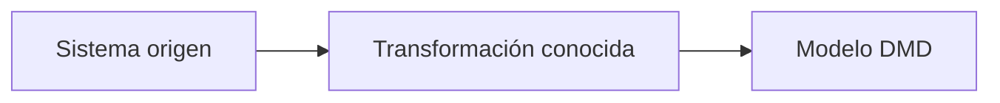

# Data Source Map — <alcance>

> **Definición:** inventario de los sistemas origen que alimentan los KPI, con su linaje, frecuencia, calidad esperada y clasificación. Se elabora a partir de documentación; no se conecta a los sistemas.
> **Regla:** calidad sin evidencia se declara `gap`, no se afirma.

## 1. Propósito
> **Contenido mínimo:** alcance de los KPI cubiertos y sistemas incluidos.

## 2. Inventario de fuentes
> **Definición:** un registro por sistema origen o archivo.
> **Contenido mínimo por fila:** ID de fuente, sistema, tipo, owner técnico, owner de negocio, frecuencia, latencia, volumen estimado, clasificación de datos y forma de acceso (sin credenciales ni cadenas de conexión).

| ID | Sistema | Tipo (BD, API, archivo, hoja) | Owner técnico | Owner de negocio | Frecuencia | Latencia | Volumen | Clasificación | Acceso |
|---|---|---|---|---|---|---|---|---|---|
| S-01 | | | | | | | | | |

## 3. Linaje
> **Definición:** camino de los datos desde la fuente hasta el modelo dimensional.
> **Contenido mínimo:** diagrama Mermaid que renderiza, y una lista de transformaciones conocidas por fuente. Sin transformaciones documentadas, «Pendiente».

## 4. Calidad esperada
> **Definición:** controles de calidad previstos por fuente.
> **Contenido mínimo:** por dimensión (completitud, unicidad, oportunidad, conciliación) el control previsto y si existe evidencia de su funcionamiento.

| Fuente | Dimensión | Control previsto | Evidencia |
|---|---|---|---|
| S-01 | Completitud | | Sin evidencia / ref. |

## 5. Matriz KPI-fuente
> **Definición:** qué fuente aporta cada elemento que necesita cada KPI.
> **Contenido mínimo:** una fila por elemento. Si no hay fuente, estado `gap` con pregunta abierta.

| KPI | Elemento necesario | Fuente | Estado |
|---|---|---|---|
| KPI-NNN | | S-01 | Cubierto / gap |

## 6. Datos personales y sensibles
> **Definición:** datos de identificación personal o sensibles presentes en las fuentes y su tratamiento.
> **Contenido mínimo:** lista de campos afectados, base de tratamiento y restricción de acceso. Si no hay, «No identificados» con la revisión realizada.

## 7. Limitaciones y pendientes
> **Contenido mínimo:** gaps abiertos, fuentes no verificadas y responsable de cada uno.

## 8. Validación
- [ ] Cada fuente tiene owner técnico y de negocio
- [ ] Ninguna cadena de conexión ni credencial aparece en el documento
- [ ] Cada elemento de KPI tiene fuente o gap
- [ ] Diagrama de linaje renderiza
- [ ] Clasificación de datos declarada por fuente
