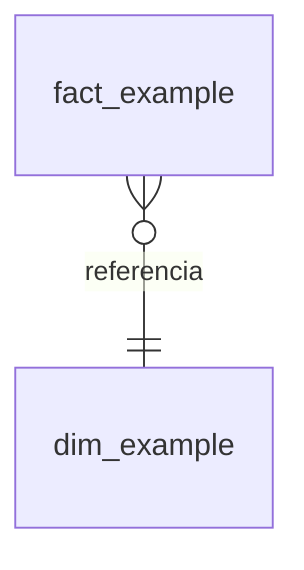

# Dimensional Model Design — <alcance>

> **Definición:** modelo dimensional de los procesos que alimentan los KPI: grano de cada tabla de hechos, dimensiones conformadas y reglas de cambio histórico. Describe el modelo; no contiene DDL ni ETL.
> **Regla:** un KPI que no se puede calcular desde el modelo bloquea el gate G4.

## 1. Procesos y grano
> **Definición:** proceso de negocio que modela cada tabla de hechos y su grano.
> **Contenido mínimo:** una fila por tabla de hechos. El grano se expresa como «una fila por <evento o estado>».

| Proceso | Tabla de hechos | Grano |
|---|---|---|
| | fact_<proceso>_<grano> | Una fila por |

## 2. Tablas de hechos
> **Definición:** medidas almacenadas en cada tabla.
> **Contenido mínimo por tabla:** grano, medidas, aditividad de cada medida (aditiva, semiaditiva o no aditiva) con su justificación y KPI que alimenta.

| Tabla | Medida | Aditividad | Justificación | KPI |
|---|---|---|---|---|
| fact_<proceso>_<grano> | | | | KPI-NNN |

## 3. Dimensiones
> **Definición:** contexto de análisis de los hechos.
> **Contenido mínimo por dimensión:** atributos, jerarquía, clave sustituta, tipo de cambio histórico (SCD 0, 1, 2 o 3) y justificación del tipo.

| Dimensión | Atributos | Jerarquía | Clave sustituta | SCD | Justificación |
|---|---|---|---|---|---|
| dim_<entidad> | | | <entidad>_key | | |

## 4. Matriz KPI-medida-fuente
> **Definición:** trazabilidad de cada medida hasta su fuente.
> **Contenido mínimo:** una fila por medida. Si la fuente no está en el DSM, estado `gap`.

| KPI | Tabla | Medida | Fuente (DSM) | Estado |
|---|---|---|---|---|
| KPI-NNN | fact_<proceso>_<grano> | | S-01 | Cubierto / gap |

## 5. Reglas de carga
> **Definición:** reglas a nivel de modelo que deben cumplir las cargas.
> **Contenido mínimo:** regla de granularidad, tratamiento de nulos, duplicados y llegadas tardías, cada una con su tabla afectada.

## 6. Diagrama
> **Definición:** representación del modelo.
> **Contenido mínimo:** diagrama Mermaid `erDiagram` con hechos, dimensiones y relaciones. Debe renderizar.

## 7. Nombres lógicos y objetos
> **Definición:** inventario de identificadores lógicos del modelo conforme al estándar de nombres del plugin `bi-analytics`.
> **Contenido mínimo:** nombres de tablas y columnas con rol/definición; PK, FK y claves de negocio; constraints de unicidad; candidatos de índices y partición con justificación o `TBD` si dependen de la plataforma. No escribir DDL.

| Objeto | Nombre | Rol/definición | Regla o referencia | Justificación / estado |
|---|---|---|---|---|
| Tabla | fact_<proceso>_<grano> | Hecho; una fila por ... | PK / FKs / grano | |
| Tabla | dim_<entidad> | Dimensión conformada | PK: <entidad>_key; business key: <entidad>_id | |
| Columna | <entidad>_key | PK sustituta / FK de rol | Referencia a dim_<entidad> | |
| Índice | ix_<tabla>_<columnas> | Candidato | Columnas y orden | Acceso esperado / TBD |

## 8. Limitaciones y pendientes
> **Contenido mínimo:** desviaciones respecto del grano requerido y decisiones pendientes con responsable.

## 9. Validación
- [ ] Cada tabla de hechos declara un grano único
- [ ] Cada medida declara aditividad
- [ ] Cada dimensión declara tipo SCD y justificación
- [ ] Cada KPI es calculable desde el modelo o tiene gap
- [ ] Diagrama Mermaid renderiza
- [ ] Tablas y campos siguen el estándar de nombres; claves, constraints e índices están inventariados y justificados
