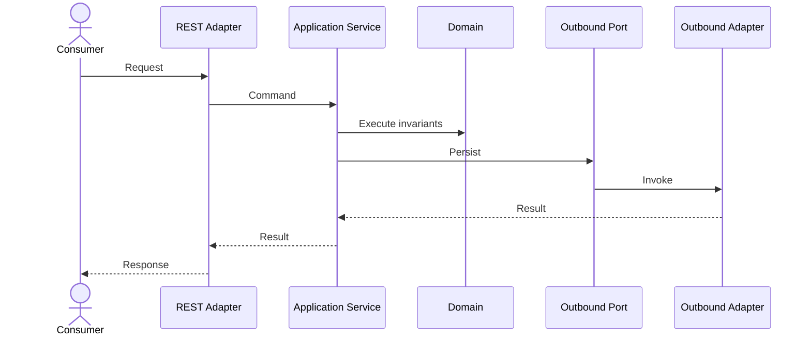

# Registrar distribuidor

> PLANTILLA: contenido ilustrativo, no evidencia de diseño aprobado. Reemplazar IDs, fecha y fuentes por datos reales.

## Propósito y alcance
- Capacidad y pre/postcondiciones: PENDIENTE.

## Trazabilidad
- DSP/SSP, US, criterios de aceptación, BR y ADR: PENDIENTE.

## Contratos
- OpenAPI `operationId`, request/response, errores, eventos: PENDIENTE.

## Modelo de dominio
- BC, AGG, VO, EVT e invariantes: PENDIENTE.

## Modelo de datos
- LDM/PDM, entidades y atributos, lecturas/escrituras: PENDIENTE.

## Interacciones
- Consumidor, inbound adapter, application service, domain, outbound ports/adapters y proveedores: PENDIENTE.

## Secuencia

## Seguridad
- Authentication, authorization, tenant isolation, audit: PENDIENTE.

## Consistencia
- Transacción, idempotencia, concurrencia, outbox: PENDIENTE.

## Resiliencia
- Timeouts, retries, fallbacks: PENDIENTE.

## Observabilidad
- Trace, correlation ID, metrics, logs: PENDIENTE.

## Pruebas
- Escenarios, casos QA, negativos, contrato, integración, regresión: PENDIENTE.

## Construcción
- Componentes, rutas conforme ADR, handoff: PENDIENTE.

## Validación
- Decisiones abiertas, evidencia, revisión humana y gate: PENDIENTE.
