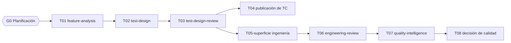
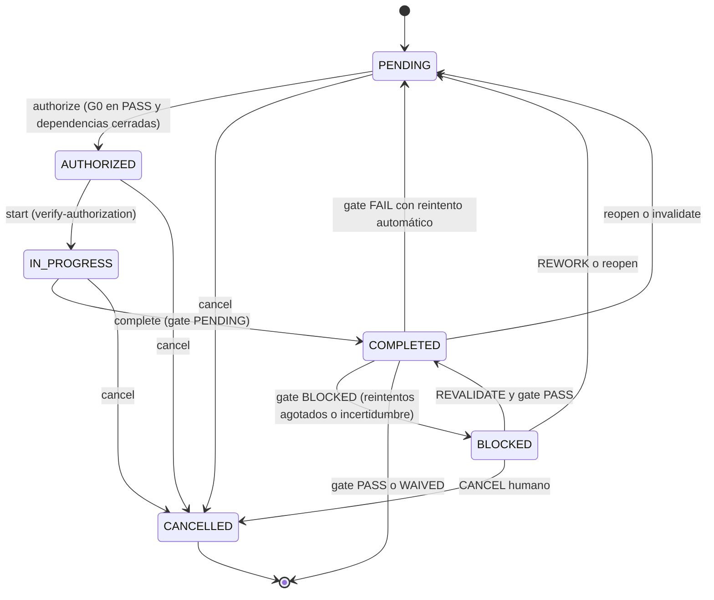

# QA Design — Documentación del plugin

Plugin de Claude Code que lleva un Development Scope Pack (DSP) validado hasta una decisión de calidad: análisis de la funcionalidad, diseño de pruebas, revisión independiente, publicación de Test Cases, ingeniería de pruebas por superficie y recomendación de calidad. Usa **un orquestador y seis skills especialistas**, con gates que fallan por defecto y puntos de aprobación humana.

- **Versión:** 2.2.0 (`plugin.json`) · **Autor:** COMSATEL · **Estándar de referencia:** STD-OKF-001 `v0.1.0-stable` (las copias del plugin aún no están propagadas, ver §8)
- **Entrada:** DSP (id, versión, ruta), `gitlab_id`, superficies a probar, artefactos disponibles. Alternativamente, solo un SSP (`--ssp-id` y `--ssp-path`): el DSP se toma de su `dsp_id` y se localiza en la KB. Con SSP, el alcance de los TC queda limitado al sprint.
- **Cadena canónica:** `DSP → US → RISK → TSN → TC → AT → EXEC → EVD → DEFECT → QUALITY_DECISION`
- **Estado operativo:** `.comsatel/qa-design/runs/<run-id>/` (solo lo escribe el orquestador). Los entregables van en `testing/<DSP-ID>/` (y `testing/<DSP-ID>/<SSP-ID>/` si hay SSP).

---

## 1. Skills

| Skill | Tarea | Qué hace | Entregable |
| :--- | :-: | :--- | :--- |
| `qa-sdlc-orchestrator` | T04, T08 y control | Planifica el DAG, autoriza tareas, evalúa gates, registra eventos y publica los Test Cases. No diseña pruebas ni interpreta calidad. | `plan.yaml`, `plan-status.yaml`, `events.jsonl`, `evidence/`, `QDC` |
| `qa-feature-analyzer` | T01 | Convierte el DSP en análisis QA: riesgos, ambigüedades, contradicciones entre criterios, evidencia y superficies. No diseña pruebas. | `QFA` |
| `qa-test-design` | T02 | Define qué probar (`TSN`) y cómo verificarlo (`TC`): estrategia, plan, priorización, matriz de cobertura y trazabilidad. | `QTD` (`QTS`, `QTP`, `TSN`, `TC`) |
| `qa-test-design-reviewer` | T03 | Revisión independiente del diseño: cobertura, trazabilidad, oracles, redundancia y superficies. El revisor no puede ser el autor. | `QTR` |
| `qa-agentic-test-engineer` | T05 (una por superficie) | Implementa y ejecuta los TC aprobados: plan de ejecución, harness, automatización, ejecuciones y evidencia. | `QTE`, `AT` |
| `qa-agentic-test-reviewer` | T06 | Revisa implementación, ejecución y evidencia de todas las superficies contra el diseño, el DSP y el entorno. | `QER` |
| `qa-quality-intelligence` | T07 | Correlaciona evidencia (ejecuciones, defectos, CI/CD, observabilidad, historia) y recomienda una decisión. No aprueba el release. | `QQI` |

Reglas comunes:

- Un especialista solo corre con una autorización del orquestador verificada por el runtime. No edita el estado, no lanza otros skills y **nunca emite `PASS`**: entrega un `gate_proposal` y decide el orquestador.
- Sin evidencia, un check es `UNCERTAIN` o `FAIL`. No hay PASS parcial: lo diferido va en `deferred_items` con una decisión humana (`decision_ref`), o el gate falla.
- No se inventan contratos ni rutas ausentes: se bloquea y se pide evidencia.
- Un TSN nunca se publica. Solo un TC aprobado puede publicarse como issue de GitLab.

---

## 2. Secuencia



| Tarea | Skill | Depende de | Ejecuta | Gate de cierre |
| :-: | :--- | :--- | :-: | :--- |
| T01 | `qa-feature-analyzer` | G0 | agente | `FEATURE_ANALYSIS_GATE` |
| T02 | `qa-test-design` | T01 | agente | `TEST_DESIGN_GATE` |
| T03 | `qa-test-design-reviewer` | T02 | agente | `TEST_DESIGN_REVIEW_GATE` |
| T04 | `qa-sdlc-orchestrator` (publicación) | T03 | orquestador | `TESTCASE_PUBLICATION_GATE` |
| T05-`<superficie>` | `qa-agentic-test-engineer` | T03 | agente | `TEST_ENGINEERING_GATE` |
| T06 | `qa-agentic-test-reviewer` | todas las T05 | agente | `TEST_ENGINEERING_REVIEW_GATE` |
| T07 | `qa-quality-intelligence` | T06 | agente | `QUALITY_INTELLIGENCE_GATE` |
| T08 | `qa-sdlc-orchestrator` (decisión) | T07 | orquestador | `HUMAN_GATE` |

- T04 y las T05 corren en paralelo tras T03. Hay una T05 por cada superficie declarada.
- Superficies válidas: `API`, `WEB`, `MOBILE`, `CROSS_SURFACE`, `DATABASE`, `EVENT`, `BATCH`, `INTEGRATION`.
- Una tarea se autoriza solo con G0 en PASS y con sus dependencias `COMPLETED` y con gate `PASS` o `WAIVED`. Nunca por la existencia de archivos.
- Orden de operación: `init` → `g0` → `authorize` → `start` → `complete` → `gate`. También hay `human`, `reopen`, `invalidate`, `cancel`, `waive`, `status`, `eligible` y `verify-authorization`.

Los estados de tarea, gate y plan, con sus transiciones y definiciones, están en las subsecciones 2.1 y 2.2.

Un cambio de DSP se maneja con `invalidate --tasks …`: reinicia esas tareas y sus sucesoras y revoca las autorizaciones.


### 2.1 Transiciones de tarea



| Estado | Definición |
| :--- | :--- |
| `PENDING` | La tarea espera. Es el estado inicial, y también el de un reintento o de una tarea reabierta o invalidada. |
| `AUTHORIZED` | El orquestador autorizó la tarea con una autorización verificable. Aún no arranca. |
| `IN_PROGRESS` | El especialista trabaja. Solo `AUTHORIZED` puede pasar aquí, lo que evita un doble despacho. |
| `COMPLETED` | El especialista terminó y entregó sus salidas. Mientras el gate esté `PENDING`, esto es terminación técnica y no cuenta como cierre. |
| `BLOCKED` | El gate no pudo aprobar sin decisión humana. Abre una intervención. |
| `FAILED` | Definido en el cálculo del plan, pero ninguna transición del código asigna este estado a una tarea (ver §6). |
| `CANCELLED` | La tarea se canceló con justificación y evidencia. Cuenta como cerrada para el plan. |

Un gate `PASS` o `WAIVED` sobre una tarea `COMPLETED` la cierra. Ver §2.2 para los estados del gate.

### 2.2 Estados de gate y de plan

| Entidad | Estado | Definición |
| :--- | :--- | :--- |
| Gate | `PENDING` | La tarea terminó técnicamente y el gate aún no se evaluó. Es el estado tras `complete`. |
| Gate | `PASS` | Todos los checks requeridos están en PASS, con evidencia. El orquestador lo registra; un PASS declarado por el especialista no basta. Habilita las tareas que dependen de esta. |
| Gate | `FAIL` | Un check no pasó y quedan reintentos. La tarea vuelve a `PENDING` con `attempts` incrementado. |
| Gate | `BLOCKED` | Reintentos agotados o incertidumbre. Abre una intervención humana y la tarea queda `BLOCKED`. |
| Gate | `WAIVED` | Cierre por dispensa registrada con evidencia. Ver la observación 7 de §6: las reglas generales dicen que ningún gate lo permite. |
| Gate | `NOT_APPLICABLE` | Declarado en el plan, sin asignación en el código actual (ver §6). |
| Plan | `PLANNED` | G0 no ha pasado ni está bloqueado. El plan existe, pero no despacha tareas. |
| Plan | `IN_PROGRESS` | G0 en `PASS` y al menos una tarea sin cerrar. |
| Plan | `BLOCKED` | G0 `BLOCKED`, una intervención humana abierta o alguna tarea `BLOCKED`. Tiene precedencia sobre los demás estados. |
| Plan | `FAILED` | Alguna tarea en `FAILED`. Depende del estado de tarea que hoy no se asigna (ver §6). |
| Plan | `COMPLETED` | Todas las tareas están `CANCELLED`, o `COMPLETED` con gate `PASS` o `WAIVED`. |

Precedencia del plan, de mayor a menor: `BLOCKED`, `FAILED`, `COMPLETED`, `IN_PROGRESS`, `PLANNED`. La calcula el orquestador tras cada comando; no la escribe nadie a mano.

---

## 3. Entregables

| Sigla | Nombre | Lo produce | Tarea |
| :-: | :--- | :--- | :-: |
| `QFA` | QA Feature Analysis Pack | `qa-feature-analyzer` | T01 |
| `QTD` | QA Test Design Pack | `qa-test-design` | T02 |
| `QTS` | QA Test Strategy | `qa-test-design` | T02 |
| `QTP` | QA Test Plan y priorización | `qa-test-design` | T02 |
| `TSN` | Test Scenario | `qa-test-design` | T02 |
| `TC` | Test Case | `qa-test-design` | T02 |
| `QTR` | QA Test Design Review | `qa-test-design-reviewer` | T03 |
| `QTE` | QA Test Engineering Pack (con Test Execution Plan) | `qa-agentic-test-engineer` | T05 |
| `AT` | Automated Test | `qa-agentic-test-engineer` | T05 |
| `QER` | QA Test Engineering Review | `qa-agentic-test-reviewer` | T06 |
| `QQI` | QA Quality Intelligence Pack | `qa-quality-intelligence` | T07 |
| `QDC` | Quality Decision | orquestador, con decisión humana | T08 |

Otros artefactos del pack `QTD`: `coverage-matrix.yaml`, `requirements-test-traceability.yaml` y `test-design-gate.md`. T04 produce las referencias a los issues de GitLab publicados.

**Entidades de trazabilidad (no son documentos):** `RISK` (riesgo), `AMB` (ambigüedad abierta), `EXEC` (ejecución), `EVD` (evidencia), `DEFECT`.

Todo Markdown entregable sigue STD-OKF-001 (`type`, `id`, `title`, `description`, `version`, `status`, `owner`, `classification`, `tags`, `generated`, `sources`).

**Política de Test Cases.** Cada `TC` en `READY` debe poder ejecutarlo un tercero sin suposiciones:

- Precondiciones `PC-*` comprobables y datos de prueba `TD-*` exactos, con la técnica de diseño usada.
- Pasos `STEP-*` numerados, con resultado esperado observable por paso.
- Oráculo con aserciones exactas, postcondiciones y trazabilidad.
- Un `Surface Target` específico que identifique el elemento bajo prueba.
- La disposición (`READY`, `BLOCKED_CLARIFICATION`, `DEFERRED`) vive en `coverage-matrix.yaml`, no en el frontmatter.
- Un TC que depende de una pregunta abierta es `BLOCKED_CLARIFICATION`: no cuenta como cubierto y el gate falla mientras siga en alcance.

---

## 4. Gates

**`G0` — Planificación.** Barrera global antes de despachar cualquier tarea. La evalúa el orquestador con cuatro checks: `dag-valid` (el DAG es válido), `inputs-identified` (DSP con id, versión, ruta y digest, y `gitlab_id`, sin marcadores de posición), `criteria-defined` (cada tarea tiene criterios, salidas y política de gate) y `surfaces-declared`. No se reanuda por decisión humana: si falla, se corrige el plan y se vuelve a ejecutar `g0`.

Los demás gates se identifican por nombre y los cierra una tarea del DAG:

| Gate | Tarea | Significado | Modo | Reintentos | Checks (según `gate-policies.yaml`) |
| :--- | :-: | :--- | :-: | :-: | :--- |
| `FEATURE_ANALYSIS_GATE` | T01 | El análisis del DSP es completo, trazable y sin conflicto de alcance. | condicional | 0 | `dsp-valid-and-verified`, `scope-complete`, `critical-risks-evidenced`, `surfaces-declared`, `no-scope-conflict` |
| `TEST_DESIGN_GATE` | T02 | El diseño cubre los riesgos críticos con TSN y TC, con oracle, datos y trazabilidad. | condicional | 0 | `tc-detail-complete`, `strategy-plan-consistent`, `critical-risk-has-tsn`, `tsn-has-tc`, `approved-tc-has-oracle-and-data`, `test-data-requirements-defined`, `test-data-safe`, `traceability-complete`, `critical-surfaces-covered`, `coverage-prioritization-defined`, `no-pending-clarification-in-scope` |
| `TEST_DESIGN_REVIEW_GATE` | T03 | Un revisor independiente confirma cobertura, oracles y detalle de los TC. | condicional | 0 | `tc-detail-complete`, `no-critical-risk-uncovered`, `no-tsn-without-tc`, `no-approved-tc-without-oracle`, `no-tc-without-test-data-requirement`, `test-data-safe`, `critical-traceability-complete`, `no-scope-or-evidence-conflict`, `reviewer-independent-of-author`, `surface-target-complete`, `tc-api-assigned`, `ssp-tc-selection`, `test-data-plan-reviewed` |
| `TESTCASE_PUBLICATION_GATE` | T04 | Solo los TC aprobados se publican en GitLab, sin duplicados ni secretos. | obligatorio | 0 | `only-approved-tc-published`, `no-tsn-published`, `issue-body-minimal`, `idempotent-no-duplicates`, `no-secrets` |
| `TEST_ENGINEERING_GATE` | T05 | Las pruebas implementadas y ejecutadas corresponden a TC aprobados, con evidencia reproducible. | condicional | 0 | `at-references-approved-tc`, `tda-traces-to-tdr-and-tc`, `test-data-ready`, `exec-evaluates-tc-oracle`, `execution-mode-requirements`, `cicd-provenance-complete`, `evidence-reproducible`, `environment-authorized`, `no-secrets-or-scope-drift`, `no-unauthorized-pii`, `no-destructive-or-unauthorized-prod` |
| `TEST_ENGINEERING_REVIEW_GATE` | T06 | La revisión independiente confirma trazabilidad AT→TC, ejecución contra el oracle y evidencia suficiente. | condicional | 0 | `at-to-tc-traceable`, `test-data-traceable`, `exec-against-oracle`, `execution-mode-explicit`, `manual-execution-evidence-complete`, `standalone-execution-reproducible`, `cicd-provenance-verified`, `evidence-sufficient`, `security-clean`, `manual-and-automated-coverage-reported` |
| `QUALITY_INTELLIGENCE_GATE` | T07 | La recomendación de calidad tiene procedencia, trazabilidad evaluada y suficiencia de evidencia declarada. | condicional | 0 | `provenance-and-scope-established`, `traceability-chain-evaluated`, `results-segmented-by-mode`, `failures-classified-by-cause`, `recommendation-issued`, `evidence-sufficiency-declared` |
| `HUMAN_GATE` | T08 | Una persona registra la decisión de calidad final. | obligatorio | 0 | `quality-decision-recorded` |

**Modos de aprobación**

- **Condicional (`CONDITIONAL_HIL`):** con todos los checks en PASS avanza solo. Sin reintentos (`max_retries: 0`), el primer `FAIL` o la incertidumbre abre una intervención humana y detiene la ejecución.
- **Obligatorio (`MANDATORY_HIL`):** siempre exige aprobación humana, ligada a la revisión exacta (digest) del artefacto. Aplica a la publicación de TC y a la decisión de calidad.

**Reglas de todos los gates**

- Fail-closed: un check faltante, evidencia ausente o resultado `UNCERTAIN` no aprueban.
- Ningún gate permite `waiver`.
- Cada check tiene un evaluador: `script` (determinista) o `independent-review` (revisor distinto del autor).
- El orquestador **no acepta PASS declarados** por quien llama: `qa_orchestrator.py gate --task <T> --checks <json> [--pack <dir>] [--design-pack <dir>] [--critical-risks <ids>]` ejecuta los verificadores (`runners`) de `gate-policies.yaml` para `TEST_DESIGN_GATE`, `TEST_DESIGN_REVIEW_GATE`, `TEST_ENGINEERING_GATE` y `TEST_ENGINEERING_REVIEW_GATE`, y su resultado manda; el PASS declarado que lo contradiga se ignora y queda como `declared_result_ignored` en la evidencia.
- Un check `script` sin verificador ejecutable (por ejemplo `environment-authorized`, `reviewer-independent-of-author`, `surface-target-complete` y los de `FEATURE_ANALYSIS_GATE`, `TESTCASE_PUBLICATION_GATE`, `QUALITY_INTELLIGENCE_GATE` y `HUMAN_GATE`) solo pasa con `attested_by: human:<id>`; la evidencia registra `source: human-attested`.
- Un check `independent-review` solo pasa con `reviewer` (`human:<id>` o `agent:<skill>`) distinto del autor de la tarea ni del orquestador.
- Un FAIL o UNCERTAIN declarado siempre se acepta (es el lado seguro). `--actor` sigue sin autenticar identidad: el plugin registra, no controla accesos.
- Un gate de salida no puede bloquear a su propia tarea productora.
- La decisión humana (`REVALIDATE`, `REWORK` o `CANCEL`) no equivale a PASS: se reevalúa el gate.
- Evidencia en `.comsatel/qa-design/runs/<run-id>/evidence/<GATE>/`.

---

## 5. Uso

```bash
python scripts/qa_orchestrator.py init ...     # crea el plan; requiere --surfaces API,WEB,... y el DSP (--dsp-id, --dsp-version, --dsp-path) o solo el SSP (--ssp-id, --ssp-path, --kb-root)
python scripts/qa_orchestrator.py g0 ...       # valida la planificación
python scripts/qa_orchestrator.py authorize ...
python scripts/qa_orchestrator.py start ...
python scripts/qa_orchestrator.py complete ...
python scripts/qa_orchestrator.py gate ...
cd qa-design && python -m pytest tests                   # pruebas del plugin
cd skills/qa-test-design-reviewer && python -m pytest tests   # pruebas de cada skill, por separado
```

Los comandos completos están en `skills/qa-sdlc-orchestrator/scripts/README.md`. Para publicar issues hace falta `GITLAB_PAT` solo en tiempo de ejecución, y `kb_local_path` y `kb_gitlab_url` por TC. La presencia estructural de un artefacto no sustituye la revisión semántica independiente.

---

## 6. Observaciones detectadas al documentar

1. **Modos de ejecución sin DAG propio.** `workflow-modes.md` define `GREENFIELD`, `BROWNFIELD` y `EVOLUTION`, pero `build_tasks()` en `qa_orchestrator.py` genera siempre el mismo DAG de ocho tareas. El plugin no distingue escenarios.
2. **Los gates no tienen código numérico.** Solo `G0` lo tiene. El resto se identifica por nombre, a diferencia de los otros plugins.
3. **README desactualizado.** Habla de "QA SDLC Pack", de la ruta `qa-sdlc-anthropic-plugin` y de habilitar `qa-sdlc-pack`, pero el plugin se llama `qa-design`.
4. **Versiones.** `plugin.json` está en 2.2.0 y los siete skills llevan `metadata.version` 1.6.0. Las pruebas `test_skill_frontmatter_and_version` (por skill) y `test_22_version_is_consistent_everywhere` (plugin) comparan esas versiones y fallan porque el plugin ya va en la línea 2.x y los skills no se alinearon. `skill-metadata-contract.yaml` exige `version`, `author` y `type: qa` (si faltan, `BLOCKED`). La numeración 5.x de §7 es histórica.
5. **Tipos documentales.** `QFA`, `QTD`, `QTP`, `QTR`, `TSN`, `QTE`, `AT`, `QER`, `QQI`, `QDC`, `TDR`, `TDA`, `EXEC` y `EVD` están aprobados en el STD-OKF-001 vigente. `QTD` se acota a cobertura, trazabilidad, TSN y TC; estrategia y plan pasan a `QTP` (aprobado en `v0.1.0-stable`). Las copias de este plugin siguen en la versión anterior hasta su propagación.
6. **Plantillas.** Cada skill guarda sus plantillas en `skills/<skill>/templates/`. La raíz del plugin no tiene `templates/` porque no hay documentos comunes a varios skills. Los registros operativos (`gate-report.yaml`) viven en `skills/qa-sdlc-orchestrator/templates/`, aunque los escriban los especialistas como `gate_proposal`.

7. **Gate `WAIVED` frente a la regla de la sección 4.** El comando `waive` existe y el orquestador acepta `WAIVED` como cierre (`GATE_OK`), pero la sección 4 dice que ningún gate permite `waiver`. Hay que decidir cuál vale.
8. **Tarea `FAILED` sin asignación.** El cálculo del plan lo usa, pero ninguna transición lo asigna a una tarea. Un fallo técnico hoy termina en `BLOCKED` o en `PENDING`.
9. **Gate `NOT_APPLICABLE` sin uso.** Aparece en la definición de estados, pero ningún código lo asigna.

---

## 7. Novedades de la versión 5.4.0 (histórico)

**Test Data.** `qa-test-design` define QUÉ datos se necesitan (`test-data-plan.md` y `TDR-*`, sin elegir el mecanismo de provisión); `qa-agentic-test-engineer` define CÓMO se crean (`TDA-*`, `test-data-generation-plan.md`, `test-data-manifest.yaml`, `test-data/`). Fuentes: SYNTHETIC, FIXTURE, REFERENCE, MASKED_COPY, GENERATED, SEEDED. Sin secretos persistidos y sin PII real no autorizada.

**Tres modos de ejecución.** `execution_mode` pertenece a cada `EXEC`: `MANUAL` (sin AT), `AUTOMATED_STANDALONE` y `AUTOMATED_CICD` (ambos exigen un AT que referencie un TC aprobado). El TC lleva `automation_status` (`MANUAL_ONLY`, `AUTOMATION_CANDIDATE`, `PARTIALLY_AUTOMATED`, `AUTOMATED`). Un re-run crea una EXEC nueva (`rerun_of`).

**GitLab CI/CD como execution engine.** No existe un skill runner: `qa-agentic-test-engineer` prepara `cicd/ci-test-execution.yaml` y fragmentos `.gitlab-ci`, y la EXEC captura provider, `pipeline_id`/URL, `job_id`/nombre y `commit_sha` reales.

**Orquestación.** Ninguna EXEC dependiente de datos pasa a READY sin TDR/TDA o una excepción con decisión humana (`scripts/exec_readiness.py`). Para evitar ambigüedad, el plan usa `workflow_modes` (GREENFIELD, BROWNFIELD, EVOLUTION) y `scheduling_mode` (SEQUENTIAL, PARALLEL_ELIGIBLE).

**Quality Intelligence.** Métricas segmentadas por modo, `automation_status`, surface, entorno, pipeline, suite, riesgo y requisito (`scripts/quality_metrics.py`); una falla de pipeline no se cuenta como falla funcional sin `failure_class`.

**Verificación.** `cd qa-design && python -m pytest tests` y las pruebas de cada skill, ejecutadas dentro de su carpeta. Los `test_skill_contract.py` se repiten por skill, así que no se pueden recolectar juntos en una sola ejecución de pytest.

---

## 8. Cambios aprobados pendientes de implementación

Estos cambios están aprobados en la conversación del 2026-11-21, pero **no están implementados**. El comportamiento descrito en las secciones 1 a 7 sigue siendo el vigente. El diseño completo está en [`docs/DISENO-separacion-actividades-qa.md`](docs/DISENO-separacion-actividades-qa.md).

- **Separación de actividades.** Planificación (`qa-test-planner`, produce `QTP`), diseño acotado a TSN, TC y TDR (`qa-test-design`), implementación manual (`qa-manual-test-engineer`) e implementación automatizada (`qa-automation-engineer`, con adaptadores para API, web y móvil). Hoy existe `qa-agentic-test-engineer`, con una T05 por superficie.
- **Vinculación TC → AUT.** Un AUT es un rol, no un documento. Se referencia desde el AT por el ID de su documento en la KB del producto (`SVC`/`HCB`, `WEB` o `MOB`). Hoy `api_id` es obligatorio en el TC, y G0 exige `scope.microservices`.
- **Expansión del plan y espera de CI.** Tras la vinculación, el orquestador crea una tarea por AUT en una nueva `plan_revision`. Las tareas automatizadas en `AUTOMATED_CICD` esperan el pipeline del MR en un estado `WAITING_EXTERNAL`. Hoy el plan tiene una T05 por superficie y no tiene estado de espera externa.
- **Manual sin documento MT.** El plan de ejecución manual vive en el `QTE`. No se crea ningún tipo `MT`.
- **Carga.** Solo API, porque las plantillas de CI cubren k6 solo para API.
- **Ruta de pruebas.** `test/` en singular, como en las plantillas de CI (`test/functional/`, `test/load/`).
- **Copias del estándar.** Las copias de este plugin siguen en `v1.3.0`. La propagación de `v0.1.0-stable` requiere clasificar su impacto, porque incluye el cambio de `QTD`.
