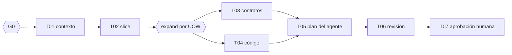

# UOW Development Design — Documentación del plugin

Lleva una User Story, el diseño de API y el diseño de BD hasta una **Unidad de Trabajo (UOW)** aprobada y lista para asignar a un developer que trabaja con un agente IA.

- **Versión:** 1.2.0 · **Autor:** COMSATEL
- **Entrada:** US (id, versión, ruta), modo y, en Brownfield y Evolution, la línea base (`ref` y `commit`).
- **Cadena:** `US → UOW → UCB, UCM, UAP → UWR → UOW_READY_GATE`
- **Estado operativo:** `.comsatel/uow-development-design/runs/` (solo lo escribe el orquestador). Los documentos van a `./management/uows/`.

---

## 1. Qué cubre y qué no

Los handoffs que ya existen se organizan por superficie o por backlog: `HCB` (un servicio), `web-development-handoff`, `mobile-development-handoff` y `data-handoff.yaml` (una superficie o una BD), `DSP` y `SSP` (muchas historias o un Sprint). Ninguno define la unidad que se entrega a **un** developer. La UOW recorta de forma transversal solo lo necesario de cada uno, con referencias por ID y versión.

| La UOW **sí** | La UOW **no** |
| :--- | :--- |
| Define el alcance y los límites de una unidad asignable | Redefine requisitos, contratos de API ni modelos de datos |
| Enlaza operaciones API y objetos de datos exactos | Inventa operaciones, campos o tablas (son brechas) |
| Fija repositorio, commit base, rutas permitidas y prohibidas | Sustituye al `HCB` ni al "Development Context Pack" de cada plugin |
| Entrega un plan verificable para el agente | Ejecuta el desarrollo ni asigna a la persona |

No existe un "Development Context Pack" único: hoy hay varias implementaciones (arquitectura, web, mobile) sin tipo OKF. La UOW cita el que corresponda.

---

## 2. Skills

| Skill | Tarea | Qué hace | Entregable |
| :--- | :-: | :--- | :--- |
| `uow-orchestrator` | G0, `expand`, T07 | Planifica el DAG, autoriza, evalúa gates, registra eventos y custodia la aprobación del paquete | `plan.yaml`, `events.jsonl`, `uow-package.yaml` |
| `uow-context-assembler` | T01 | Reúne los insumos con versión y clasifica cada afirmación | `UCX` |
| `uow-slice-designer` | T02 | Parte la US en una o más UOW (slice vertical) | `UOW` |
| `uow-contract-binder` | T03 | Enlaza API y BD exactos y verifica coherencia | `UCB` |
| `uow-codebase-mapper` | T04 | Repositorio, commit base, límites y análisis del código existente | `UCM` |
| `uow-agent-execution-planner` | T05 | Plan para el agente (neutral y perfil Claude Code con Superpowers) | `UAP` |
| `uow-readiness-reviewer` | T06 | Revisión independiente del paquete | `UWR` |

Reglas comunes: un especialista solo corre con autorización del orquestador, nunca emite `PASS` (entrega un `gate_proposal`) y no cambia el estado. Sin evidencia un check es `UNCERTAIN` o `FAIL`. No hay PASS parcial.

---

## 3. Secuencia



- `expand --uows UOW-001,UOW-002 [--depends UOW-002=UOW-001]` solo se acepta con T02 `COMPLETED` y `SLICE_GATE` en PASS, y una sola vez. La partición en UOW la valida el gate.
- Cada UOW avanza de forma independiente (T03 y T04 en paralelo; T05 espera a ambas).
- Las dependencias entre UOW (`depends_on_uow`) fijan el orden de desarrollo, no el de diseño.

### Modalidades
| Modo | Efecto |
| :--- | :--- |
| `GREENFIELD` | El UCM propone la estructura destino a partir de ADR y convenciones; no hay código que analizar. |
| `BROWNFIELD` | Línea base obligatoria (G0 y UCX). El UCM analiza el código existente de la zona a tocar. |
| `EVOLUTION` | Como Brownfield, más compatibilidad hacia atrás, regresión y rollback. |

---

## 4. Gates

| Gate | Tarea | Modo | Reint. | Checks `script` |
| :--- | :-: | :--- | :-: | :--- |
| `CONTEXT_GATE` | T01 | condicional | 2 | `sources-versioned`, `claims-separated`, `unknowns-listed`, `mode-baseline-consistent` |
| `SLICE_GATE` | T02 | condicional | 2 | `criteria-assigned-to-uow`, `uow-boundaries-defined`, `dependencies-acyclic`, `uow-traces-to-us` |
| `BINDING_GATE` | T03 | condicional | 2 | `api-operations-resolved`, `db-objects-resolved`, `api-db-consistent`, `contract-versions-pinned` |
| `CODEBASE_GATE` | T04 | condicional | 2 | `repo-ref-pinned`, `allowed-paths-defined`, `forbidden-zones-defined`, `baseline-analysis-present`, `compat-and-rollback-present` (solo exige contenido en EVOLUTION) |
| `AGENT_PLAN_GATE` | T05 | condicional | 2 | `steps-verifiable`, `tests-before-code`, `stop-conditions-defined`, `deviation-protocol-present`, `no-secrets`, `dod-measurable` |
| `READINESS_GATE` | T06 | condicional | 1 | `package-complete`, `traceability-complete`, `reviewer-independent-of-author`, `open-questions-handled` |
| `UOW_READY_GATE` | T07 | **obligatorio** | 0 | `package-digest-matches`, `review-recommendation-ready` + aprobación humana |

Cada gate suma checks `independent-review` (conflictos, tamaño asignable, contratos inventados, ADR, acciones destructivas, alcance inventado). Ningún gate admite `waiver`. La aprobación de `UOW_READY_GATE` queda ligada al digest de `uow-package.yaml`: cualquier cambio posterior la invalida.

---

## 5. Documentos (tipos aprobados)

| Sigla | Nombre | Contenido clave |
| :--- | :--- | :--- |
| `UCX` | UOW Context Pack | Insumos con versión; hechos, inferencias, supuestos y desconocidos; criterios de la US; línea base |
| `UOW` | Unit of Work | Objetivo, alcance (incluye y excluye), criterios cubiertos, dependencias, criterios de terminado, dimensión, riesgos, handoff a QA |
| `UCB` | UOW Contract Binding | `api_operations`, `data_objects`, mapeo API→columna, brechas |
| `UCM` | UOW Codebase Map | `repository` (mismo bloque que `HCB`), `allowed_paths`, `forbidden_paths`, ADR, análisis |
| `UAP` | UOW Agent Execution Plan | Pasos con prueba primero, verificación, condiciones de parada, protocolo de desviaciones |
| `UWR` | UOW Readiness Review | Hallazgos, alcance inventado, recomendación propuesta |

Ruta canónica sin run-id: `./management/uows/UCX-NNN-<slug>.md`, `UOW-NNN-<slug>.md` y `UOW-NNN/` (UCB, UCM, UAP, UWR y `uow-package.yaml`). El ciclo de la UOW va en `scope_state` (`DRAFT`, `IN_REVIEW`, `READY_FOR_ASSIGNMENT`, `SUPERSEDED`); `status` queda para el estado documental.

---

## 6. Agente: Claude Code con Superpowers

El `UAP` es neutral. El perfil `claude-code-superpowers` añade:
- un plan en formato `writing-plans` (tareas pequeñas, archivos exactos, prueba primero, comando de verificación y commit), ejecutable con `superpowers:subagent-driven-development` o `executing-plans`;
- un brief para el `CLAUDE.md` del repositorio con los límites, las reglas de parada y el flujo sugerido.

Si Superpowers no está instalado, el perfil neutral sigue siendo válido.

---

## 7. Limitaciones conocidas

- Los tipos `UOW`, `UCX`, `UCB`, `UCM`, `UAP` y `UWR` están aprobados en STD-OKF-001 v0.1.0-stable.
- Los checks `independent-review` requieren un `reviewer` (`human:<id>` o `agent:<skill>`) distinto del autor de la tarea y del orquestador; el plugin no puede verificar quién es esa persona, solo registra la declaración.
- El orquestador **no acepta PASS declarados** para los checks `script`: `uow_orchestrator.py gate --task <T> --checks <archivo.json> --pack <raíz> [--human-approval <archivo.json>]` ejecuta `check_uow_package.py` con el perfil del gate (`runners` de `gate-policies.yaml`) y su resultado manda; el PASS declarado que lo contradiga se ignora (`declared_result_ignored` en la evidencia). Sin `--pack`, un check `script` solo pasa con `attested_by: human:<id>` (`source: human-attested`). Un FAIL o UNCERTAIN declarado siempre se acepta. `--checks` acepta la lista o la salida de `check_uow_package.py` (`{"checks": [...]}`).
- No se probó contra una invocación real de agentes en Claude Code: los scripts y el estado se prueban de forma aislada.
- La plantilla Task-Dev de project-management dice hoy "una US = una unidad, sin tareas". Enlazar la UOW con ese issue requiere un cambio aparte en project-management.
- Una nueva partición de la US en UOW exige un plan nuevo (`expand` es de una sola vez).

---

## 8. Verificación

```
python -m pytest plugins/uow-development-design/tests
python -m pytest plugins/uow-development-design/skills/<skill>/tests
```
